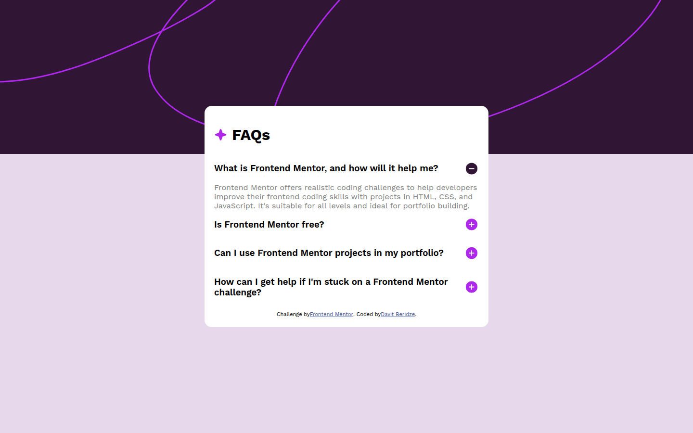
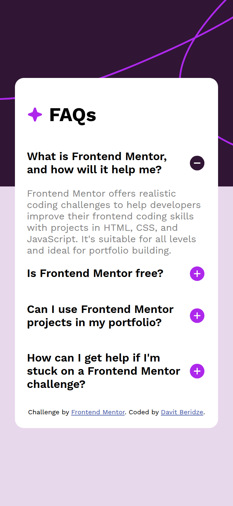

# FAQ Accordion

My solution to the [FAQ accordion](https://www.frontendmentor.io/challenges/faq-accordion-wyfFdeBwBz) challenge on Frontend Mentor. An FAQ card where each question expands to show its answer.





## Features

- Click a question to show or hide its answer
- Plus and minus icons that reflect the open state
- Responsive background and card width

## Built with

- Semantic HTML
- CSS with Flexbox and media queries
- Vanilla JavaScript for the accordion

## Run locally

No build step or dependencies. Open `index.html` in a browser, or serve the folder:

```bash
npx serve .
```
